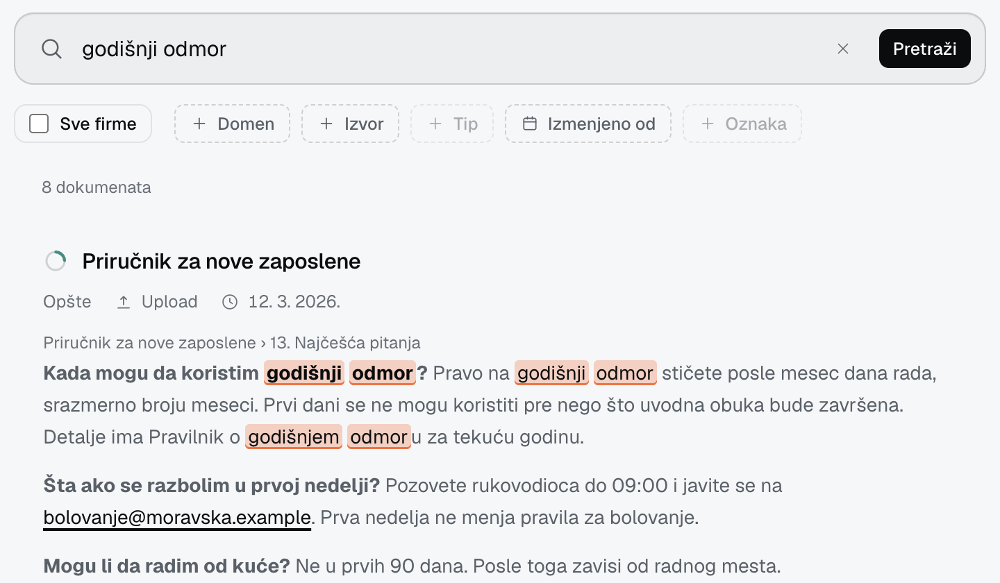

Provereno na Izumi 0.5.7, 2026-11-21.

Izumi je zajednički sloj znanja za firmu. Pitate, a Izumi vraća odlomke iz dokumenata vaše firme, sa izvorom, autorom i svežinom. Odgovor ne piše Izumi. Odgovor sastavljate vi ili AI alat koji koristite.

<Frame>
  
</Frame>

## Šta dobijate

- Pretragu na **Početna**. Pišete pitanje na srpskom ili engleskom, latinicom ili ćirilicom. Dobijate dokumente i odlomke, samo iz domena u kojima imate ulogu.
- Pitanja iz AI alata koji već koristite: ChatGPT, Claude (claude.ai i Claude Desktop), Claude Code i Slackbot. Ne otvarate posebnu aplikaciju.
- Samo ono što smete da vidite. Firma je granica podataka, domen je oblast znanja, a uloga vezuje osobu za domen. Isto važi za AI alat koji povežete.
- Predloge beleški. AI alat može da predloži belešku, a urednik domena je odobrava ili odbija u **Red za pregled**. Dok je ne odobri, niko je ne nalazi pretragom.
- Pregled znanja: lista **Dokumenti** i **Struktura i zdravlje**, mapa koja pokazuje odakle znanje dolazi i koliko je ažurno, a ne sam sadržaj.
- "Ko zna": pitate AI alat ko u firmi zna neku temu i dobijate listu kolega. To je predlog koga da pitate, ne garancija (opis je iz koda).

## Odakle znanje dolazi

- Google Drive i SharePoint, samo čitanje. Izumi ne menja fajlove u Drive-u ni u SharePoint-u.
- Otpremanje Markdown (.md) i tekstualnih (.txt) fajlova, i .zip fajla sa njima. Drugi tipovi se preskaču (iz koda).
- Push API za slanje dokumenata iz drugih sistema.
- Web clip: proširenje za Chrome ili Edge čuva stranicu koju čitate, tek kad pritisnete dugme, i samo u domen u kojem ste urednik.

## Za koga je

- Korisnici pretražuju i povezuju AI alat. Počnite od stranice [Brzi start](/sr/upoznaj/brzi-start).
- Urednici domena odobravaju predložene beleške.
- Admini firme upravljaju članovima, domenima, izvorima i podešavanjima.
- Oni koji odlučuju: [Kako radi pristup](/sr/upoznaj/pristup) i [Bezbednost i podaci](/sr/upoznaj/bezbednost).

## Ograničenja

- Pretraga uvek vraća najbliže rezultate, čak i za besmislen upit. Rezultat na vrhu ne znači da odgovara: pročitajte odlomak.
- Izumi ne piše odgovore. Po kodu ne šalje mejl i ne briše dokumente po roku.
- Cursor, Windsurf, Cline, VS Code, Zed i Continue nisu probani. Za njih postoji opšta stranica [Ostali klijenti](/sr/ai-alati/ostali-klijenti).

## Dalje

- [Pretraga](/sr/koriscenje/pretraga), [Predlozi i pregled](/sr/koriscenje/predlozi), [Ko zna](/sr/koriscenje/ko-zna) i [Web clip](/sr/koriscenje/web-clip) opisuju svakodnevni rad.
- [Pregled AI alata](/sr/ai-alati/pregled) vodi do povezivanja ChatGPT-a, Claude-a, Claude Code-a i Slacka.
- Izvori: [Google Drive](/sr/admin/izvori-drive), [Microsoft 365](/sr/admin/izvori-microsoft), [Upload](/sr/admin/izvori-upload) i [Push API](/sr/admin/push-api).
